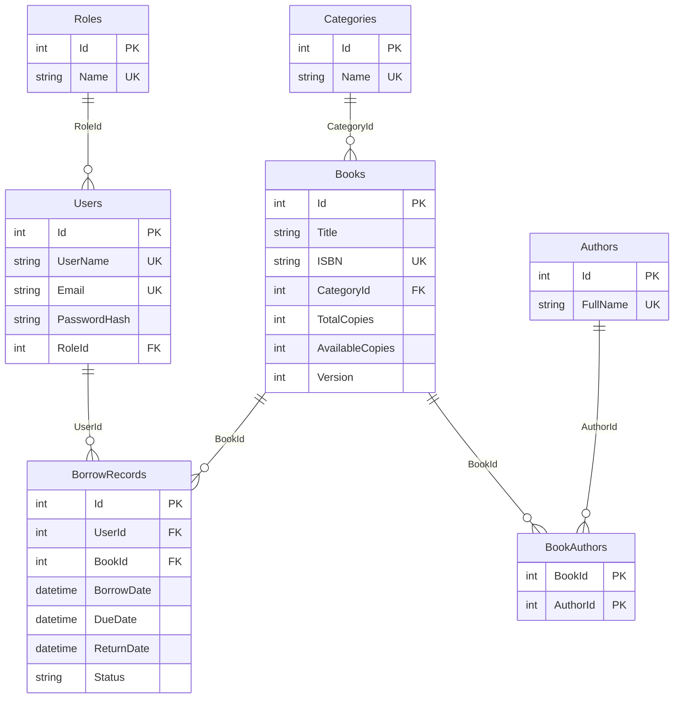

# Library Management API

ბიბლიოთეკის სისტემა: ASP.NET Core 8 Web API + EF Core (Code First) + MS SQL Server + JWT. ფრონტი (`LibraryApi/wwwroot/index.html`) API-სთან ერთად ეშვება.

## გაშვება

1. დააყენეთ .NET 8 SDK და SQL Server (ან LocalDB).
2. `LibraryApi/appsettings.json`-ში შეცვალეთ `ConnectionStrings:Default` და `Jwt:Key`.
3. Migration-ის შექმნა (ერთხელ):
   ```
   dotnet tool install --global dotnet-ef
   cd LibraryApi
   dotnet ef migrations add InitialCreate
   ```
4. გაშვება (ბაზა ავტომატურად შეიქმნება და შეივსება):
   ```
   dotnet run
   ```
5. გახსენით: საიტი `/`, Swagger `/swagger`.

საწყისი Admin: `admin@library.ge` / `Admin123!` (appsettings-ში `Admin` სექცია).

რეალური საიდუმლოებისთვის: `dotnet user-secrets set "Jwt:Key" "..."` ან გარემოს ცვლადი `Jwt__Key`.

## ტესტები

```
dotnet test LibraryApi.Tests
```

## ER დიაგრამა


